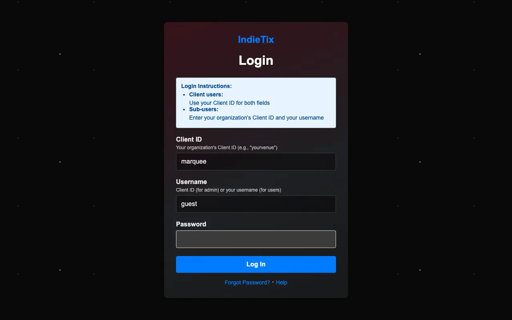

# Getting started

How a venue signs up, how staff log in, and the first settings to fill in.

## Signing up (hosted IndieTix)

1. On the signup page, enter the venue's name and contact details, and optionally pick a web address (yourvenue.indietix.net).
2. Sign in with Square using the venue's Square account and approve IndieTix's access.
3. About a minute later the box office is ready, and a welcome email arrives with the venue's **Client ID** and a link to set the password.

The Client ID and the main login's username are the same.

**Promoters without a venue** sign up the same way, with their own Square account (a free Square account works). Skip the theater and box-office report settings; set your **Event Locations** to the rooms you book, and your promoter name as the **Event Distributor** under Square Ticket Items.

## Logging in

1. Open your venue's web address (for example yourvenue.indietix.net). The **Client ID** is filled in for you there.
2. Enter your **Username** and **Password**. For the venue's main login, the username is the Client ID.
3. Choose **Log In**. You land on the first page your permissions allow, and the menu shows only what you can use.

- **Forgot your password?** Staff accounts can use "Forgot password" on the login page.
- **Lost the venue's main (client) login password?** Email support from the venue's contact address; IndieTix resets it after checking it's really the venue.
- A login lasts up to 24 hours. Changes to a staff account's permissions take effect the next time that person logs in.

## First things to set up

Log in with the venue's main login and open **Client Settings**. Fill in these first; each has its own page in this guide.

1. **Theater Settings:** the venue name shown in the header (Web Header Company) and your logo ([Settings and your web address](10-settings-and-your-web-address.md)).
2. **Event Locations:** your rooms or stages, so showtimes can say where they are.
3. **User Names:** the people who process refunds, for the refund form's "Processed By" list.
4. **Square Ticket Items:** your ticket types and prices for new movies and events ([Adding movies and events](04-adding-movies-and-events.md)).
5. **Sender Email:** the address ticket emails come from.
6. **OMDB API Key:** a free key from omdbapi.com, so Movie Info Lookup can find films.
7. **Terms & Privacy Pages:** the venue's legal name and contact details for its own terms and privacy pages.
8. **Staff accounts:** add them in **User Management** ([Staff and permissions](09-staff-and-permissions.md)).
