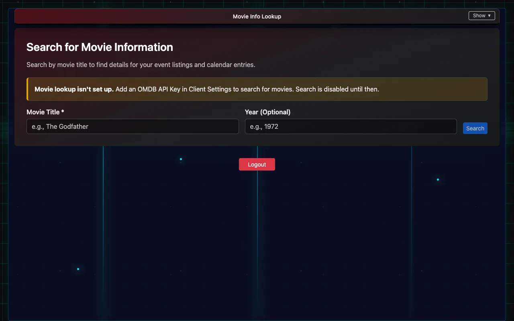
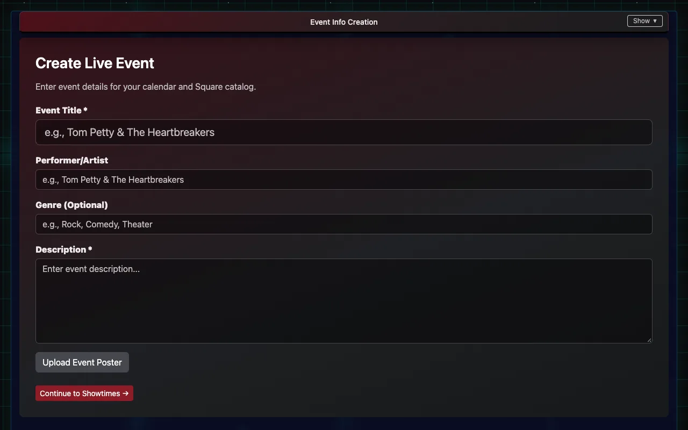
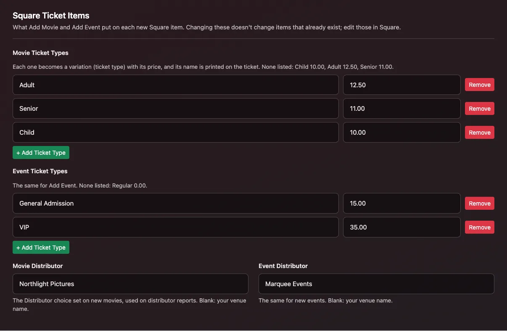
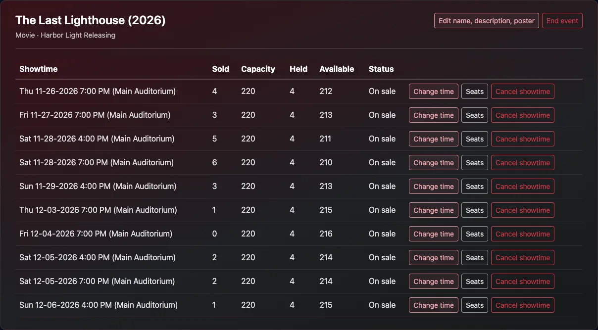
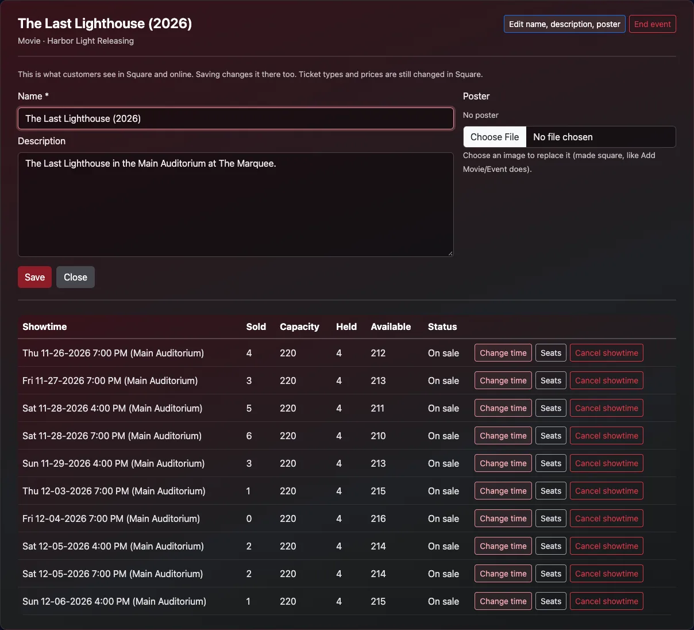

# Adding movies and events

Add a show once and IndieTix creates the Square item for you: the ticket types, the prices and every showtime. It then sells at the register and online the same way. After that, manage its showtimes, seats, name, description and poster on the **Showtimes** page; changes go to Square straight away. You need edit permission.

## Add a movie

1. Open **Movie Info Lookup**.
2. Type the **Movie Title** (and the **Year** if there are several films with that name), then **Search**. This needs an OMDB API key in Client Settings.
3. Pick the film from **Search Results**. Check its details: title, rating, runtime, cast and plot.
4. Optionally **Upload Custom Poster** to replace the poster.
5. Under **Add Showtimes**, pick the **Date**, **Time** and **Location** (a room from Client Settings → Event Locations), add any **Descriptors** (such as "Closed Caption" or "21+"), and choose **+ Add Showtime**. Repeat for every showtime.
   - **Capacity** starts at the room's seats from Client Settings (blank means no limit); change it for this showtime if you like. **Held seats** (passes, guests) are taken off what can be sold. See [Seats and selling out](#seats-and-selling-out).
6. Tick **Create event(s) in Google Calendar** if you use it (set up in Client Settings).
7. Choose **Create Item in Square**. The message tells you it's done, reminds you to set the item to pickup only on Square Online, and links to **Manage its showtimes** on the Showtimes page.

## Add a live event

1. Open **Event Info Entry**.
2. Fill in the **Event Title** and **Description**, plus the performer and genre if you like, and optionally **Upload Event Poster**.
3. Choose **Continue to Showtimes →**.
4. Add each showtime as for a movie: **Date**, **Time**, **Location**, optional **Descriptors**, **Capacity** and **Held seats**, then **+ Add Showtime**.
5. Choose **Create Item in Square**.

## Ticket types and prices

New items get the ticket types listed in **Client Settings → Square Ticket Items**: one list for movies and one for events, each a name and a price (for example Adult 12.50, Senior 11.00). With none listed, movies get Child 10.00, Adult 12.50 and Senior 11.00, and events get Regular 0.00. Each type's name is printed on the ticket and used on reports.

The same section sets the **Movie Distributor** and **Event Distributor** that new items are tagged with for box-office reports (blank means the venue's name).

## The Showtimes page

Open **Showtimes** and pick a movie or event. The table lists each showtime with how many tickets are sold, its capacity, held seats, how many are still available, and whether it's on sale, sold out, past or cancelled. Tick **Include archived** to see shows with no upcoming showtimes.

- **Add a showtime:** fill in the form under the table (**Date**, **Time**, **Room**, any extras, **Capacity** and **Held seats**) and choose **Add showtime**. It goes on sale in Square right away. Adding one to an archived show puts the show back on sale.
- **Change a showtime:** choose **Change time** on its row to change the date, time, room or extras. This only works before any ticket is sold for it, because sold tickets show the old time; once one is sold, cancel it and add a new one instead.
- **Change the seats:** choose **Seats** on its row. Capacity and held seats can change at any time, even after sales, but never to fewer than are already sold.
- **Cancel a showtime:** choose **Cancel showtime**. It comes off sale online and at the register. **Tickets already sold are not refunded**: the message says how many there are, so you can refund them on **List Orders**. Cancelling a show's last upcoming showtime archives it in Square.

## Edit or delete a movie or event

- **Name, description and poster:** on the Showtimes page, pick the show and choose **Edit name, description, poster**. The form shows what customers see now. Change what you need (choose an image file to replace the poster) and **Save**. The Square item changes too, so there's no need to edit it in Square. Tickets already sold keep the name they were bought under.
- **Delete event:** a show nothing was ever sold for is deleted completely, in IndieTix and in Square. This can't be undone.
- **End event:** once any ticket has been sold for a show, even one that was later refunded, the button says **End event** instead, so its sales history and reports are kept. Its upcoming showtimes come off sale and the item is archived in Square. **Nothing is refunded automatically**: the message says how many tickets for those showtimes need refunding on **List Orders**.
- **Ticket types and prices** are still changed in Square (see [Variations are the ticket types](#how-a-ticket-item-is-built-in-square)). Changing Client Settings only affects items created afterwards.

Make these changes on the Showtimes page rather than in Square. IndieTix checks every night for showtimes, names, descriptions or posters changed directly in Square; if it finds any, support may get in touch so the two can be put back in step.

## Seats and selling out

- Each room's seat count is set once in **Client Settings → Event Locations** (the **Seats** box next to each room). A new showtime starts with its room's seats as its capacity. Blank means no limit.
- **Held seats** are seats you keep back (passes, guests, staff). Available = capacity − held seats − tickets sold.
- To stop selling a showtime once it's full, tick **Stop selling a showtime when it's full** under Event Locations. A full showtime is then removed from Square online and at the register automatically, and goes back on sale if a refund or more seats free a place. Without it, capacity is only shown, never enforced.
- Square's own stock counts are separate: they count per ticket type across every showtime, not per showtime.

## Bring in shows already in Square

Shows created before IndieTix had the Showtimes page (or made by hand in Square) can be brought in: on the Showtimes page choose **Bring in existing Square items**. It first shows what it would bring in (each show and its number of showtimes, and any showtimes already full) and asks before changing anything. Square isn't changed; IndieTix makes its own copy and links tickets already sold to their showtimes. Shows already brought in are skipped, so it's safe to run again.

A show whose Square item shares its **Show Time** list with another item can't be brought in, because each showtime can belong to only one show. Its tickets still sell, email and scan as normal.

## When showtimes pass

**Past showtimes** are removed automatically a few hours after they start, and when every showtime has passed the item is archived in Square. To extend a run, add a showtime on the Showtimes page (tick **Include archived** to find the show).

## How a ticket item is built in Square

Add Movie and Add Event build all of this for you, and the Showtimes page changes it for you. It's here for when someone needs to change an item by hand in Square, or make one from scratch (then use **Bring in existing Square items** so it appears on the Showtimes page).

**1. The item's custom attributes.** These are set on the item, in the custom attributes section of Square's item editor.
- **UseQRCode** (yes/no): this is the switch. IndieTix only makes tickets for items where UseQRCode is turned on. If an item sells but no tickets go out, check this first.
- **EventType** (a choice, for example Movie or Live): what kind of event it is, used on reports.
- **Distributor** (a choice): who the film or show comes from, used on box office and distributor reports. Add Movie and Add Event set the choice named in **Client Settings → Square Ticket Items** (Movie Distributor / Event Distributor; blank means the venue's name). If that name isn't one of the attribute's choices in Square, the item is created without it and IndieTix says so: add the choice in Square and set it on the item.
- **Online Display Name** (text): the name shown online, usually the same as the item name.
- If any of the four is missing from the venue's Square account, Add Movie or Add Event creates it the first time. If UseQRCode can't be created, IndieTix stops and doesn't create the item, so an item never sells without making tickets. When making them by hand, use exactly these names. Setting one on a single variation instead of the item overrides the item's value for that ticket type only.

**2. Variations are the ticket types.** Each variation is one kind of ticket with its own price. The variation's name is printed on the ticket as its type and used on reports, so name them the way you want them to read (for example "Student" or "VIP").
- To change a price on an existing item, edit that variation's price in Square.
- To add a ticket type, add a variation to the item. It's ticketed automatically, because UseQRCode is set on the item.
- Square counts stock per variation, not per showtime. If stock tracking is on, the count covers every showtime of that ticket type.

**3. The "Show Time" modifier list holds the date and time.** Each item has its own modifier list named **Show Time**, set to require exactly one choice, so every sale picks a showtime. Each modifier is one showtime, priced at $0.
- Write each showtime exactly like this: `Sun 01-18-2026 7:00 PM (Spacement)`. That's the day, the date as MM-DD-YYYY, the time with AM or PM, and the room in parentheses. Leave off the parentheses if the venue has one room.
- IndieTix reads the date and time for the ticket, the door scanner and reports from this text, and the room from the parentheses. A typo in the date can put the wrong date on tickets, so copy an existing showtime and change only what differs.
- For a show on the Showtimes page, add and cancel showtimes there, not in Square. For an item made by hand that hasn't been brought in, add a modifier to its Show Time list in the same format, or remove one to cancel it (refund anyone who already bought it, through IndieTix).
- Keep the list's name as Show Time, and give each item its own list. Don't share one list across items, because the cleanup works per list.

**4. Cleanup.** A few hours after a showtime starts, IndieTix removes it from the list so it can't be sold. When every showtime on an item has passed, the list is removed and the item is archived in Square.

**Other settings.**
- Each unit sold is one ticket: a quantity of 4 makes 4 tickets.
- On Square Online, set ticket items to **pickup only** (no shipping or delivery).
- An item made by hand, rather than in IndieTix, works the same way if it follows steps 1 to 3.
