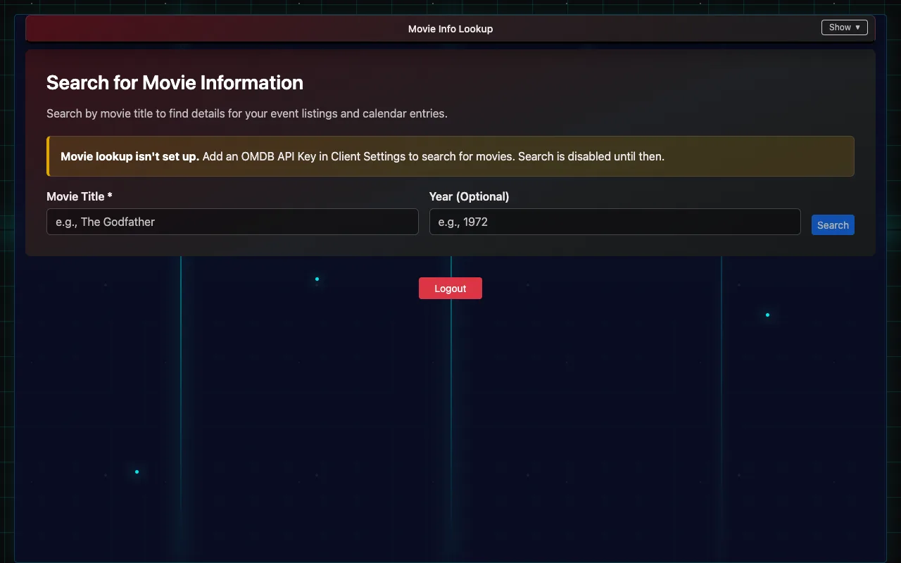
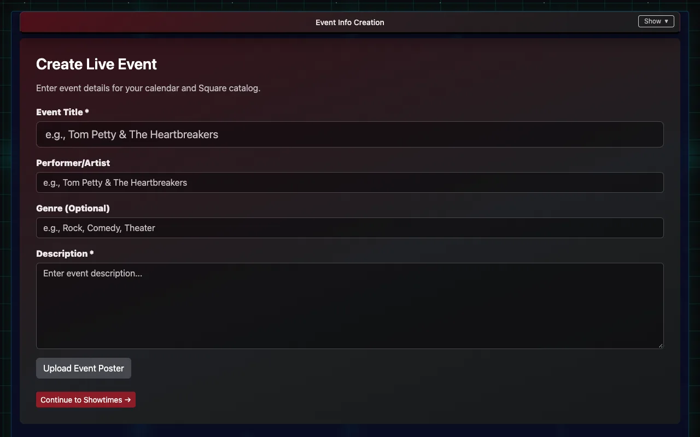
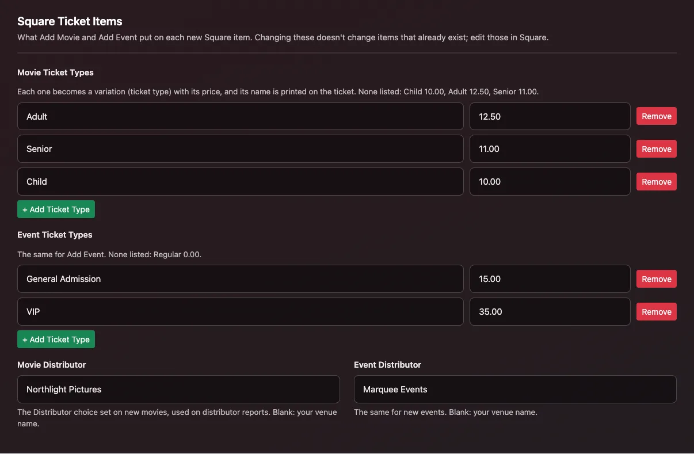

# Adding movies and events

Add a show once and IndieTix creates the Square item for you: the ticket types, the prices and every showtime. It then sells at the register and online the same way. You need edit permission.

## Add a movie

1. Open **Movie Info Lookup**.
2. Type the **Movie Title** (and the **Year** if there are several films with that name), then **Search**. This needs an OMDB API key in Client Settings.
3. Pick the film from **Search Results**. Check its details: title, rating, runtime, cast and plot.
4. Optionally **Upload Custom Poster** to replace the poster.
5. Under **Add Showtimes**, pick the **Date**, **Time** and **Location** (a room from Client Settings → Event Locations), add any **Descriptors** (such as "Closed Caption" or "21+"), and choose **+ Add Showtime**. Repeat for every showtime.
6. Tick **Create event(s) in Google Calendar** if you use it (set up in Client Settings).
7. Choose **Create Item in Square**. The message tells you it's done, and reminds you to set the item to pickup only on Square Online.

## Add a live event

1. Open **Event Info Entry**.
2. Fill in the **Event Title** and **Description**, plus the performer and genre if you like, and optionally **Upload Event Poster**.
3. Choose **Continue to Showtimes →**.
4. Add each showtime as for a movie: **Date**, **Time**, **Location**, optional **Descriptors**, then **+ Add Showtime**.
5. Choose **Create Item in Square**.

## Ticket types and prices

New items get the ticket types listed in **Client Settings → Square Ticket Items**: one list for movies and one for events, each a name and a price (for example Adult 12.50, Senior 11.00). With none listed, movies get Child 10.00, Adult 12.50 and Senior 11.00, and events get Regular 0.00. Each type's name is printed on the ticket and used on reports.

The same section sets the **Movie Distributor** and **Event Distributor** that new items are tagged with for box-office reports (blank means the venue's name).

## Changing a show after it's created

- **Prices, showtimes and descriptions** are changed in Square: edit the item there. Changing Client Settings only affects items created afterwards.
- **Past showtimes** are removed automatically a few hours after they start, and when every showtime has passed the item is archived in Square. Archived items can be restored in Square if a run is extended.

## How a ticket item is built in Square

Add Movie and Add Event build all of this for you. It's here for when someone needs to change an item by hand in Square, or make one from scratch.

**1. The item's custom attributes.** These are set on the item, in the custom attributes section of Square's item editor.
- **UseQRCode** (yes/no): this is the switch. IndieTix only makes tickets for items where UseQRCode is turned on. If an item sells but no tickets go out, check this first.
- **EventType** (a choice, for example Movie or Live): what kind of event it is, used on reports.
- **Distributor** (a choice): who the film or show comes from, used on box office and distributor reports. Add Movie and Add Event set the choice named in **Client Settings → Square Ticket Items** (Movie Distributor / Event Distributor; blank means the venue's name). If that name isn't one of the attribute's choices in Square, the item is created without it and IndieTix says so: add the choice in Square and set it on the item.
- **Online Display Name** (text): the name shown online, usually the same as the item name.
- If any of the four is missing from the venue's Square account, Add Movie or Add Event creates it the first time. If UseQRCode can't be created, IndieTix stops and doesn't create the item, so an item never sells without making tickets. When making them by hand, use exactly these names. Setting one on a single variation instead of the item overrides the item's value for that ticket type only.

**2. Variations are the ticket types.** Each variation is one kind of ticket with its own price. The variation's name is printed on the ticket as its type and used on reports, so name them the way you want them to read (for example "Student" or "VIP").
- To change a price on an existing item, edit that variation's price in Square.
- To add a ticket type, add a variation to the item. It's ticketed automatically, because UseQRCode is set on the item.
- Square counts stock per variation, not per showtime. If stock tracking is on, the count covers every showtime of that ticket type.

**3. The "Show Time" modifier list holds the date and time.** Each item has its own modifier list named **Show Time**, set to require exactly one choice, so every sale picks a showtime. Each modifier is one showtime, priced at $0.
- Write each showtime exactly like this: `Sun 01-18-2026 7:00 PM (Spacement)`. That's the day, the date as MM-DD-YYYY, the time with AM or PM, and the room in parentheses. Leave off the parentheses if the venue has one room.
- IndieTix reads the date and time for the ticket, the door scanner and reports from this text, and the room from the parentheses. A typo in the date can put the wrong date on tickets, so copy an existing showtime and change only what differs.
- To add a showtime, add a modifier to that item's Show Time list in the same format. To cancel one, remove its modifier, but refund anyone who already bought it, through IndieTix.
- Keep the list's name as Show Time, and give each item its own list. Don't share one list across items, because the cleanup works per list.

**4. Cleanup.** A few hours after a showtime starts, IndieTix removes it from the list so it can't be sold. When every showtime on an item has passed, the list is removed and the item is archived in Square.

**Other settings.**
- Each unit sold is one ticket: a quantity of 4 makes 4 tickets.
- On Square Online, set ticket items to **pickup only** (no shipping or delivery).
- An item made by hand, rather than in IndieTix, works the same way if it follows steps 1 to 3.
