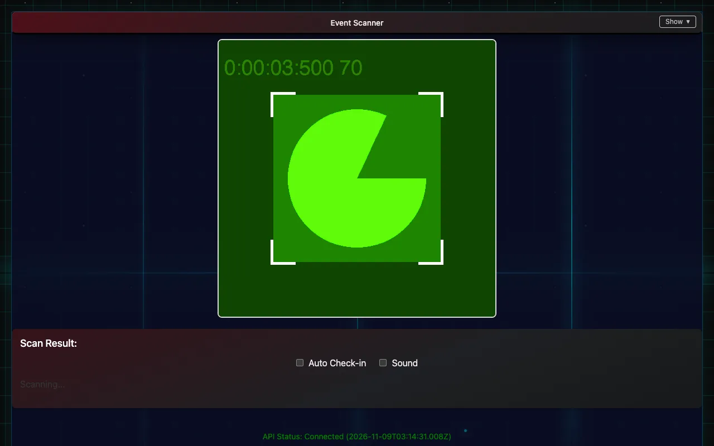
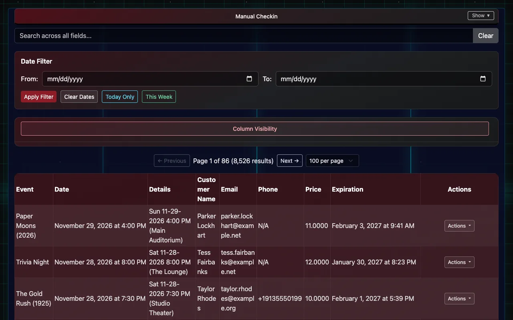
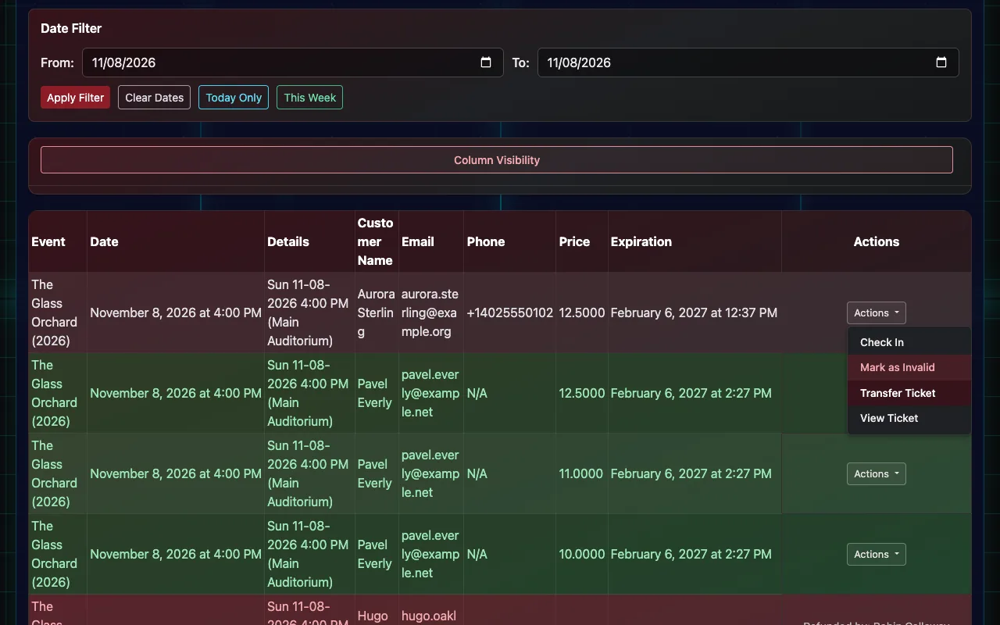
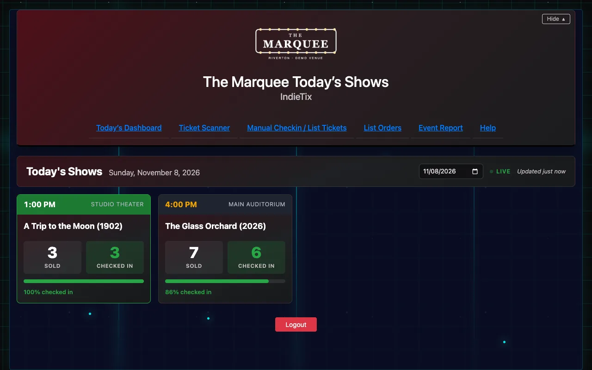

# At the door

Checking people in: the scanner, looking tickets up by hand, today's numbers, comps and printing.

## Scan tickets

1. On any phone, tablet or laptop with a camera, log in and open **Ticket Scanner**. There's no app to install; phones use the rear camera.
2. Allow camera access when the browser asks.
3. Point the camera at the ticket's QR code, on the buyer's phone screen or a printout. The **Scan Result** shows the ticket and whether it's valid.
4. With **Auto Check-in** on, a valid ticket is checked in the moment it's scanned. With it off, confirm each check-in yourself. **Sound** plays a tone on each scan.

- Scanning a ticket twice shows "already checked in", not an error.
- Refunded, cancelled and transferred tickets are refused.
- **A USB or Bluetooth handheld scanner** also works: use the search box on **Manual Checkin / List Tickets**, since most handheld scanners type like a keyboard.

## Check in by hand

When a code won't scan, or the buyer only has their name:

1. Open **Manual Checkin / List Tickets**.
2. Search by name, email or code, or use **Today Only** and the date filter to narrow the list. Long lists come a page at a time: use **Previous** and **Next**, or choose how many to show per page.
3. On the ticket's row, open **Actions** and choose **Check In**, then **Confirm Check-in** (or **Confirm Check-in & Print** to print a stub as well).

The same menu can **Check Out** a ticket checked in by mistake, **Transfer Ticket** to someone else, **View Ticket**, **Print Ticket**, or **Mark as Invalid**. Marking a ticket invalid stops it working at the door but doesn't return any money: to refund, use **Refund Order** on the Orders page ([Orders, refunds and resends](06-orders-refunds-and-resends.md)). **Column Visibility** chooses which columns show.

## Today's Dashboard

**Today's Dashboard** shows each of today's shows with tickets sold and checked in so far, for whoever's running the door. It refreshes on its own. Choose a date to look at another day; **Today** comes back to today.

## Extra staff on a busy night

Create a staff account in **User Management** (new accounts can only check people in) and log in on another phone ([Staff and permissions](09-staff-and-permissions.md)).

## Skeleton keys (comps and re-entry)

Reusable QR codes for comps, re-entry or staff, set up in **Client Settings → Skeleton Keys**. Each can have limits (uses per day, total uses, an expiry date), can be revoked, and every use is logged.

## Printing paper ticket stubs (optional)

- Uses a Brother QL-series network label printer at the box office and a small print agent running on a computer on the same network.
- Then use **Print Ticket** on a ticket, **Print Tickets** on an order (prints every valid ticket on it), or **Confirm Check-in & Print** at the door.
- **Prints failing or "connection timed out"?** Turn the printer off and on, make sure it's on the network, and check only one copy of the print agent is running. Setting printing up the first time: a person from IndieTix helps with that.
