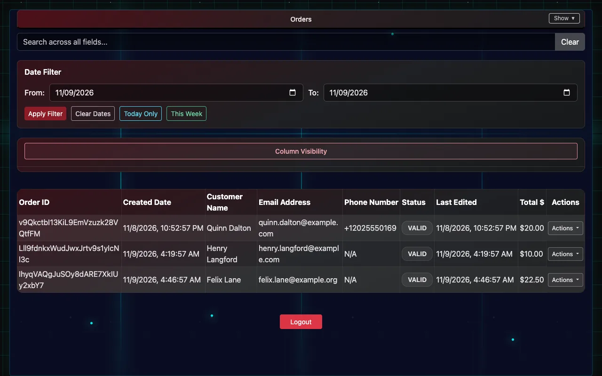
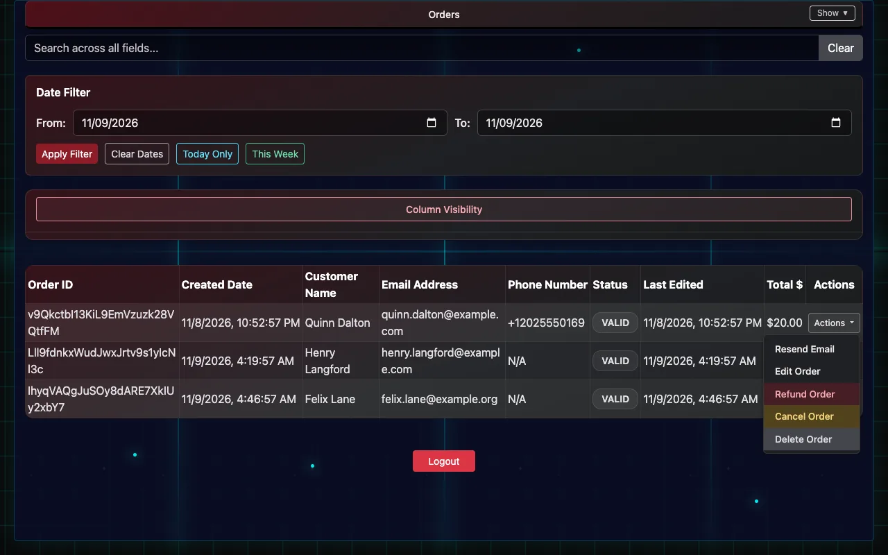
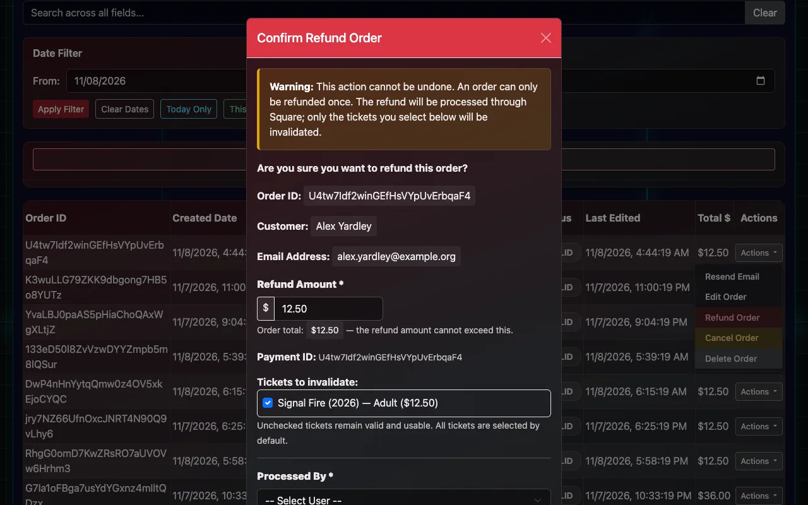

# Orders, refunds and resends

Finding an order, resending tickets, fixing contact details, refunds, cancellations and transfers.

**List Orders** shows every order, newest first: who bought, when, the total and its status. Search by name, email, phone or order ID, filter by date (**Today Only**, **This Week**, or a range), and open **Order Details** to see the tickets on it. You need view or edit permission.

## Resend a ticket email

1. Find the order and check the email address on it.
2. If the address is wrong, open **Actions → Edit Order**, fix the name, email or phone, and **Update Order**.
3. Open **Actions → Resend Email** and confirm. The tickets go to the address on the order.

Only the buyer's name, email and phone can be changed on an order. Price and showtime changes happen in Square.

## Refund an order

1. Find the order and open **Actions → Refund Order**.
2. Check the **Refund Amount**. It starts at the order total; lower it for a partial refund.
3. Under the list of tickets, leave ticked the tickets that should stop working. Unticked tickets stay valid.
4. Pick who's processing it under **Processed By** (the names come from Client Settings → User Names) and write the **Reason for Refund**.
5. Choose **Process Refund**. Square returns the money to the buyer's card, the refunded tickets are refused at the door straight away, and the order shows who refunded it and why.

- An order can only be refunded once.
- **Refund through IndieTix, not in Square's own dashboard or app.** A refund made in Square returns the money but doesn't stop the tickets working.

## Cancel or delete an order

**Cancel Order** and **Delete Order** (in the same Actions menu) mark an order cancelled or deleted, with who did it and why, and its tickets stop working. Neither returns money: use **Refund Order** for that.

## Transfer a ticket to someone else

1. Open **Manual Checkin / List Tickets** and find the ticket.
2. Open **Actions → Transfer Ticket**.
3. Enter the new person's first and last name and email (phone optional), then **Transfer Ticket**.

The old ticket stops working and a new one is emailed to the new person. A ticket that's already checked in can't be transferred.

## Print every ticket on an order

With a box-office label printer set up, **Actions → Print Tickets** prints every valid ticket on the order, in order.
