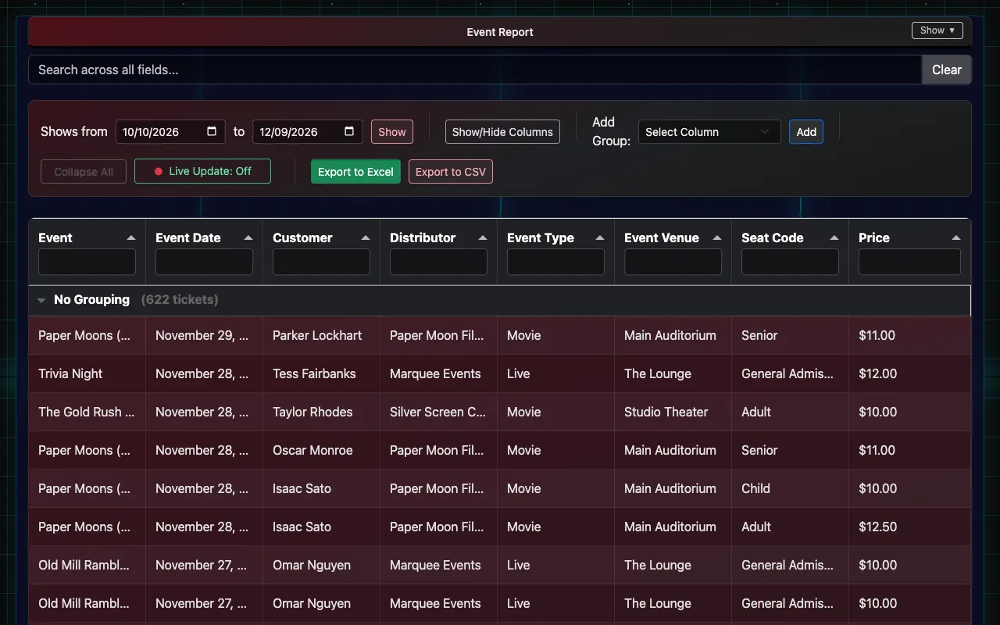
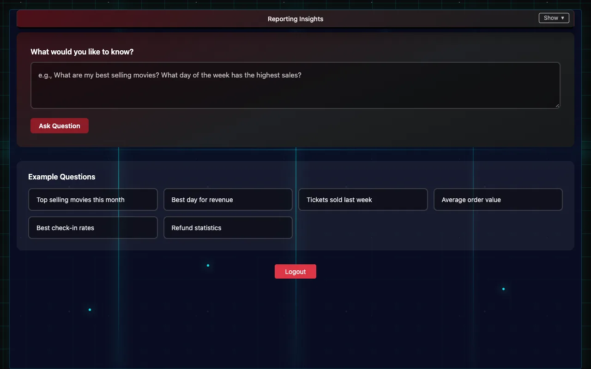

# Reports and Insights

What sold, what checked in, and the nightly box-office reports cinemas send to distributors.

## Event Report

The **Event Report** lists every ticket with its event, showtime, ticket type, price and check-in status. You need view or edit permission.

1. Open **Event Report**.
2. Group the list: pick a column under **Add Group** (Event, Event Date, Distributor, Event Type, Event Venue, Seat Code, Check-in Status or Customer) and choose **Add**. Add more groups to nest them, for example Event, then Event Date.
3. Each group shows its ticket count and totals. **Collapse All** folds them up.
4. **Live Update** keeps the report refreshing on its own, handy during a show.
5. **Export to Excel** or **Export to CSV** downloads what you see.

## Insights

**Insights** answers questions about your sales in plain English, such as "how many tickets did we sell last weekend?" or "which films had the best check-in rate?". It needs admin permission and the venue's own Anthropic API key in **Client Settings → API Configuration**.

1. Open **Insights** and type your question, or choose one of the **Example Questions**.
2. Choose **Ask Question**. The answer comes from your own data only.
3. **Show SQL Query** shows exactly how it was worked out.

Insights only reads your sales data; it can't change anything.

## Box-office reports to distributors (cinemas)

Cinemas that report to film-industry services (for example comScore/Rentrak) can have the daily box-office files sent automatically every night.

1. In **Client Settings → Theater Settings**, enter your **Theater ID**, **Theater Name**, **EBOR Theatre No.**, **Sales Tax Rate (%)** (the part of the ticket price that's tax) and **Screen Numbers** (which room is which screen).
2. Under **FTP Settings**, turn on **Enable FTP uploads** and enter each destination your reporting services gave you.

If a delivery fails, the venue's contact email gets an alert saying what failed.
