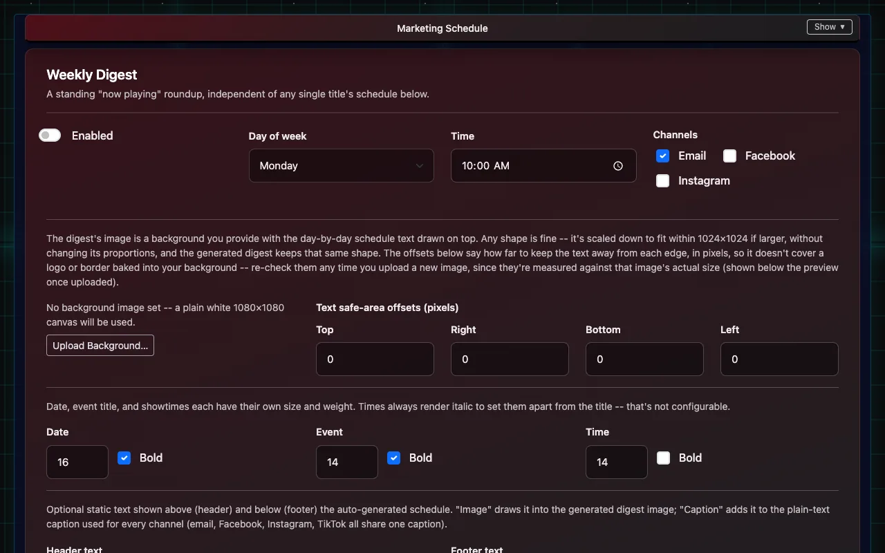

# Marketing and texting

Posting upcoming shows to social media and email, and sending tickets by text.

## Marketing posts

The **Marketing Schedule** plans posts for each movie or event on email, Facebook and Instagram (TikTok is waiting on TikTok's approval of IndieTix). You need marketing permission.

1. Open **Marketing Schedule**. Your upcoming Square items are listed under **Campaign Schedules**.
2. Open an item's schedule and choose when posts go out (for example an announcement, reminders and opening day). Presets cover common patterns.
3. IndieTix makes a draft for each post. Open **Marketing Posts** (in the menu, or from the summary at the bottom of Marketing Schedule) to read them. **Edit** changes the caption or replaces the image.
4. Approve the posts you want: **Approve** on one post, tick several and choose **Approve selected**, or **Approve all drafts for this show**. Each asks first and says how many posts it will approve. **Nothing posts until someone approves it**; approved posts go out at their scheduled time (Central time).

**Marketing Posts** has four tabs: **Needs review** (drafts) and **Scheduled** (approved) list the soonest first; **Sent** and **Problems** (failed or skipped) list the newest first. Posts are grouped by show, a page at a time, and can be narrowed by show, channel, dates or caption text. Sent posts are kept as history and can't be deleted.

- Captions start from the item's Square description, followed by the price and ticket link. They can be written by AI instead, if turned on for that schedule.
- The picture is the item's image in Square. Instagram pictures are fitted to Instagram's allowed shape automatically.
- **Weekly Digest** sends a "what's playing" roundup on the day and time you choose.
- **Facebook and Instagram** need the venue's Meta Page Access Token, Facebook Page ID and Instagram Business Account ID in **Client Settings → Social Media Integration**. Instagram must be a business or creator account linked to the Facebook Page.

## Email list

**Email List** holds your marketing email subscribers: add an address, search, and see who's unsubscribed. Ticket emails go to every buyer regardless; marketing emails only go to people on the list, and every one has an unsubscribe link.

## Text-message tickets

- Buyers can choose to get their tickets by text. The ticket email includes a link to opt in; once someone has opted in, later tickets are texted automatically.
- Only one text is sent per ticket: the ticket itself. No marketing texts.
- Anyone can reply **STOP** to stop texts from that venue, **START** to turn them back on, or **HELP** for help.

## Why texting isn't on straight away

US phone carriers require every business that sends texts to register first (called "10DLC"). Each venue gets its own registration, phone number and opt-out list, so one venue's texts never affect another's.

- Registration needs the venue's business details, sample messages and a description of how people opt in, and the carriers review it. Approval usually takes 1 to 4 weeks.
- Carriers charge a small monthly fee for each registration, paid by the venue.
- Until it's approved, tickets go by email only; nothing else changes.

A person from IndieTix helps each venue through registration.
