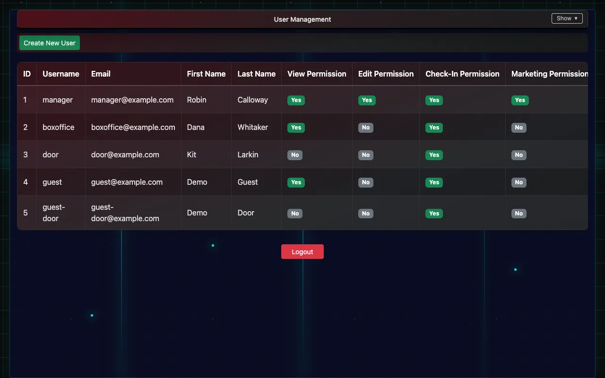
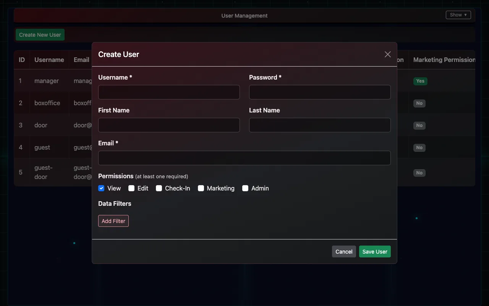

# Staff and permissions

The venue's main login (the "client" login) can do everything. Everyone else gets their own staff account, with only the permissions they need.

## Add a staff account

1. Log in with the venue's main login and open **User Management**.
2. Choose **Create New User**.
3. Enter a **Username**, **Password** and **Email** (for password resets), and their name if you like.
4. Tick their **Permissions**. New accounts start with **Check-In** only.
5. Optionally add **Data Filters** (below), then **Save User**.

They log in with the venue's Client ID, their username and their password.

## What each permission allows

| Permission | Allows |
|---|---|
| Check-In | Ticket Scanner, Today's Dashboard, Manual Checkin / List Tickets |
| View | The above, plus List Orders and Event Report |
| Edit | The above, plus Movie Info Lookup and Event Info Entry |
| Marketing | Marketing Schedule and Email List |
| Admin | Insights |

Client Settings, User Management, Skeleton Keys, API Keys and Privacy Requests are only available to the main login.

## Limit someone to certain events

**Data Filters** limit a staff account to matching tickets and orders: by event name (exact, or containing some words), by date, or by event type (Movie or Live). Use them for a promoter who should only see their own show's sales, or door staff for one room. Add several filters to allow any of them.

## Changing or removing access

Edit or delete the account in **User Management**. Changes take effect the next time that person logs in, and a login lasts up to 24 hours.
