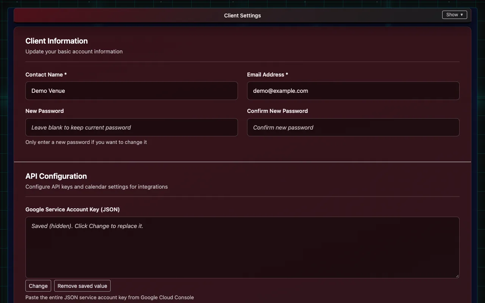

# Settings and your web address

**Client Settings** holds everything about the venue's setup. Only the venue's main login can open it. Fill in a section and choose its save button; passwords and keys are never shown again after they're saved (choose **Change** to replace one).

## What each section is for

| Section | What's in it |
|---|---|
| Client Information | Contact name and email for the venue (alerts and IndieTix notices go here), and the main login's password |
| API Configuration | Google Calendar, the Anthropic key for Insights, the OMDB key for movie lookups, the Sender Email for tickets, an Owner BCC Email that gets a copy of every ticket email, a Walk-up Phone saved on register sales with no buyer phone, and One Per Email Items |
| Square Payment Settings | Your web address, and Connect Square |
| Theater Settings | Names, logo and the box-office report details |
| Square Ticket Items | Ticket types, prices and distributors for new movies and events |
| Social Media Integration | Facebook, Instagram and TikTok accounts for marketing posts |
| Event Locations | Your rooms or stages |
| Event Descriptors | Labels for showtimes, such as "Closed Caption" or "21+" |
| User Names | The names in the refund form's "Processed By" list |
| Ticket Settings | Ticket layout (portrait or landscape) |
| FTP Settings | Where nightly box-office reports are delivered |
| Communication Settings | Text-message tickets on or off (once texting is approved) |
| Terms & Privacy Pages | The venue's legal details for its own terms and privacy pages |
| Skeleton Keys | Reusable QR codes for comps, re-entry and staff |
| API Keys | Keys for partners and kiosks using IndieTix's public API |

## Your logo

Under **Theater Settings**, choose **Upload Logo** to use your own on the staff pages and tickets, or **Use Default Logo** for the IndieTix logo.

## Your web address

Each venue can pick its own address, like yourvenue.indietix.net, under **Square Payment Settings → Your IndieTix web address** (or at signup), then **Save Address**. Its login page fills in the Client ID, and its terms and privacy pages show the venue's own details (entered under **Terms & Privacy Pages**).

## API keys

Partners and kiosks can sell or look up tickets through IndieTix's public API with a key made under **API Keys**. Each key has its own permissions and can be limited to certain events; it's shown once when made, so store it safely. Revoke a key to stop it working.
