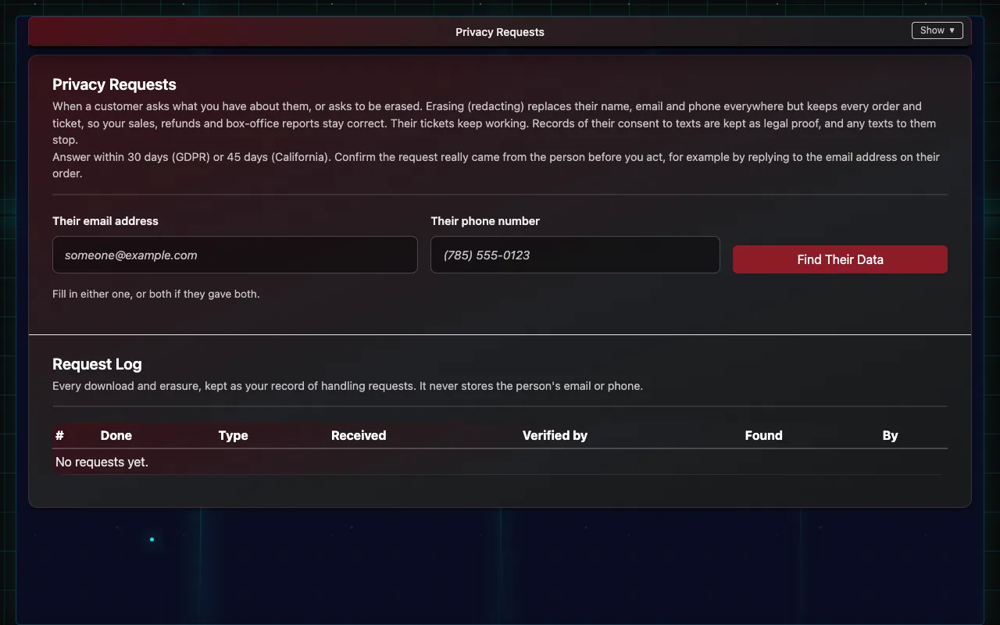
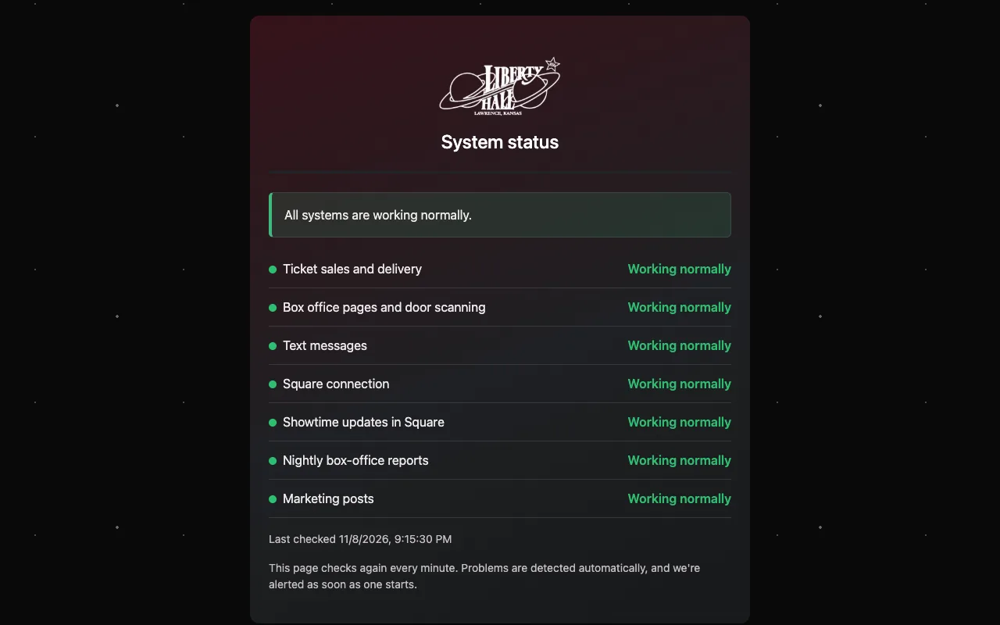

# Privacy, your account and status

Handling a ticket buyer's privacy request, closing an account, and checking whether something is down.

## Privacy requests from ticket buyers

When someone asks a venue what it holds about them, or asks to be erased:

1. Confirm the request really came from that person, for example by replying to the email address on their order.
2. Log in with the venue's main login and open **Privacy Requests** (linked from Client Settings).
3. Enter their email address or phone number and choose **Find Their Data**. **What we found** lists their orders and tickets.
4. Note how you confirmed it's them and the date the request came in.
5. Choose **Download Their Data** to give them a copy, or **Erase Their Details** to remove their name, email and phone everywhere.

Erasing keeps the sales themselves, so reports stay correct and their tickets keep working. Every request is kept in the **Request Log**, without their email or phone.

A ticket buyer with a privacy request should contact the venue that sold the ticket. Privacy questions about IndieTix itself are answered personally by IndieTix.

## Closing an account

Email support from the venue's contact address. IndieTix confirms, then deletes the venue's data. Removing IndieTix's access in Square stops new orders reaching IndieTix straight away.

## Is something down?

The status page (status.html on the venue's site) shows whether ticket sales and delivery, the box office pages and door scanning, text messages, nightly reports and marketing posts are working. IndieTix is alerted automatically when something fails.

## Reporting a security problem

Please don't put details in an email to support. Use GitHub's private "Report a vulnerability" on https://github.com/indieTix-net/indietix (Security tab), or email indietix@indietix.net.
